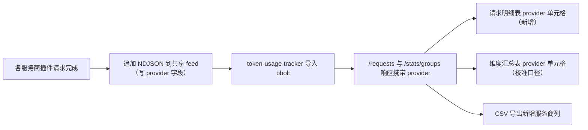

# Token 用量面板新增「服务商」列需求

结论：在 `workbuddy-token-usage` 用量看板的请求明细表中新增「服务商」列，并让维度汇总表的同名列统一为同一口径，使用户能直接从看板看到每条请求来自哪个服务商插件（如 `qoder-ai-provider`、`cursor-provider`、`qoderwork-provider`、`traework-provider`、`workbuddy-ai-provider`、`workbuddy-provider`、`zcode-provider`、`Antigravity`、`gemini-provider` 等）；影响：请求明细表与维度汇总表新增 / 校准一列，CSV 导出同步扩列；范围：`token-usage-tracker` 面板列定义、单元格渲染、排序、CSV 导出与四个语言包表头；非范围：不修改后端采集链路、不修改用量统计口径、不修改其它插件、不改动宿主核心；完成标准：请求明细表与维度汇总表都能显示原始 provider id，面板回归脚本与 Go 侧门禁全绿；术语说明：服务商指产生该次请求的上游插件 provider（对应用量记录的 `provider` 维度与 feed 行的 `provider` 字段）；验证状态：真实测试与格式门禁均已通过。

## 需求来源

- 用户表述：Token 用量统计插件要新增一个列，说明「来自哪个服务商」，例如 `qoder-ai-provider`、`cursor-provider`、`qoderwork-provider`、`traework-provider`、`WorkBuddy AI`、`workbuddy-provider`、`zcode-provider`、`Antigravity` 等，需要知道请求来自哪个服务商。
- 附件：`C:\Users\luode\.qoder\tmp\F--cpa-plugin\images\...\26a5044d-85e7-4bf1-8882-d57dceca53ae.png`（看板截图，当前模型不支持读图，以代码事实为准）。

## 需求澄清结论

| 项 | 结论 |
| --- | --- |
| 展示形态 | 原始 provider id（不做友好名替换），与插件 id / registry / 日志完全一致 |
| 作用范围 | 请求明细表新增该列；维度汇总表已有的 provider 列同步校准为同一口径 |
| 数据来源 | 用量记录 `Dimensions.Provider`，面板 `/requests` 与 `/stats/groups` 响应已携带 `provider` |
| 兼容性 | 无需数据迁移；历史记录同样带 `provider` 字段 |

## 现状与缺口

- 后端已就绪：`usage_stats/request_log.go` 的 `RequestDetail` 内嵌 `Dimensions`，`/requests` 与 `/stats/groups` 响应天然携带 `provider` 字段；各服务商插件（workbuddy、workbuddy-ai、traework、qoder-ai、qoderwork、cursor、zcode、gemini）写入 feed 时都显式写入 `provider`。
- 前端缺口：`usage_stats/dashboard.go` 的请求明细表 `requestColumns` 只有 `time`/`model`/`source`/`session_key`/…，**没有任何列暴露 `provider`**，`requestDataCell` 与 `requestSortValue` 也没有 provider 分支，导致用户无法从请求明细看到服务商。
- 前端已有但口径待统一：维度汇总表 `dimensionColumns` 已含 `{key:'provider',label:'table.provider'}`，与本次新增列需保持同一原始 id 口径。
- 语言包已就绪：`table.provider` 在 zh-CN / zh-TW / en / ru 四语言包均已存在（提供商 / Provider / 提供商 / провайдер）。

## 业务链路

## 验收标准

- `AC-01`：请求明细表表头含「服务商」列。
- `AC-02`：请求行「服务商」单元格显示原始 provider id（如 `qoder-ai-provider`、`workbuddy-provider`）。
- `AC-03`：维度汇总表「服务商」单元格显示同一批原始 provider id。
- `AC-04`：「服务商」列可参与排序。
- `AC-05`：CSV 导出表头含服务商列，导出行含 provider 值。
- `AC-06`：四语言包 CSV 表头同步扩列，无编码漂移。

## 非范围

- 不改动 feed 采集、bbolt 存储结构与统计聚合口径。
- 不引入服务商友好展示名替换（本轮明确采用原始 id 口径）。
- 不修改其它插件与宿主。
