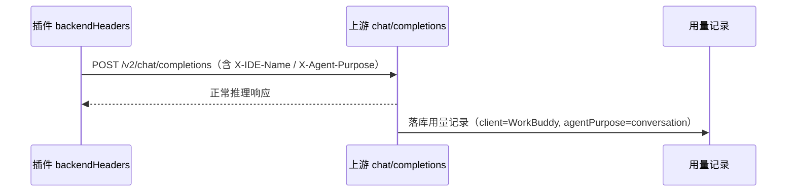

# WorkBuddy 推理请求补齐使用端标识需求

结论：为 `workbuddy-ai`（国际版）与 `workbuddy`（CN）两个插件的聊天补全请求补齐使用端标识头，使上游用量记录的使用端字段由空值变为 `WorkBuddy`，与官方客户端一致；影响：上游按使用端归属的运营活动（含活动积分赠送）此前无法识别插件请求；范围：两个插件的 `backendHeaders` 请求头构造与版本号；非范围：不修改签到、计费、调度等其它链路，不改动宿主核心；完成标准：单变量对照证明标识头决定使用端字段 + 两插件本地编译单测全绿；术语说明：使用端即上游用量记录中的 `client` 维度，`agentPurpose` 为请求用途维度；验证状态：请求头契约对照与本地回归已完成，生产安装复验待并行会话发布收口后进行。

## 需求来源

- 用户表述：WorkBuddy AI 国际版推理请求在官方记录中带使用端标识，插件接入的请求没有标识；官方说明只有使用端为 WorkBuddy 才会有活动的积分赠送，因此需要插件的推理请求都带上使用端为 WorkBuddy 的标识。
- 附件：上游 `get-user-request-usage` 原始返回（官方客户端请求 `client:"WorkBuddy"`、插件请求 `client:""`）；两张官方说明截图（当前模型不支持读图，以接口返回与客户端代码事实为准）。

## 需求澄清结论

| 项 | 结论 |
| --- | --- |
| 标识字段 | 使用端 = 请求头 `X-IDE-Name`（值 `WorkBuddy`）；请求用途 = `X-Agent-Purpose`（值 `conversation`） |
| 判定依据 | 官方桌面客户端 `app.asar` 内 chat 请求头构造函数明文可读，两域契约一致 |
| 作用范围 | 两插件 `backendHeaders` 单点注入，覆盖流式、探活、故障重试全部聊天链路 |
| 与 `X-IDE-Type` 的关系 | 一并补齐以完整对齐官方客户端，但实测其不决定 `client` 字段 |

## 验收标准

- **AC-001**：仅发 `X-IDE-Name` 时上游 `client` 字段为 `WorkBuddy`，仅发 `X-IDE-Type` 时仍为空。
- **AC-002**：仅发 `X-Agent-Purpose` 时上游 `agentPurpose` 为 `conversation`，且两字段互不依赖。
- **AC-003**：CN 与国际版两侧规律一致。
- **AC-004**：两插件 `cgo-shim` build/vet/test 全绿，且哨兵测试确证真实进编译。
- **AC-005**：补齐后请求头与官方客户端契约一致（含 `X-IDE-Type`）。

## 风险与边界

- 上游「活动积分赠送」为发放规则，补头是必要条件但无法从契约上保证积分到账；最终需真实对照观察积分变化。
- 请求头属协议固定字段，取值保持与官方客户端逐字一致，不做本地化或改写。
